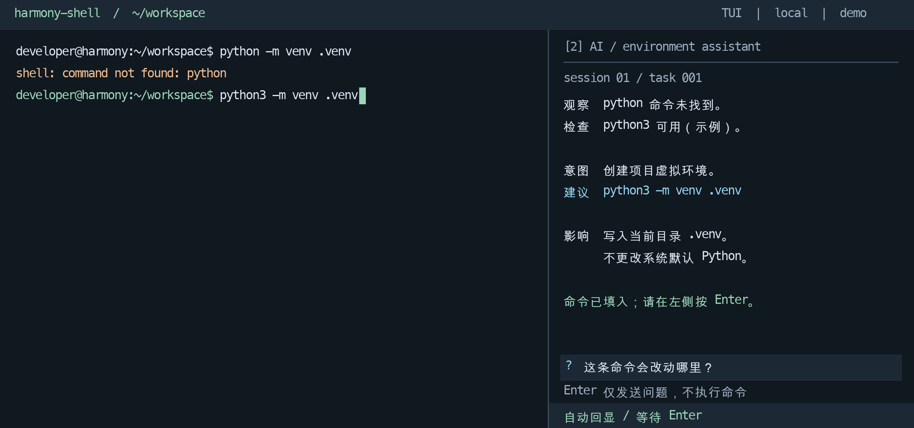

# ohos_ai_shell

面向 Harmony / OpenHarmony 命令与开发环境场景的智能 Shell 设计项目。

保留普通 Shell 的操作习惯，在独立 AI 侧栏中解释问题、检索适配知识和提出可追溯方案。通过校验的命令直接进入可编辑提示符，**用户按 Enter 才执行**。

> 当前阶段：产品与技术设计、开发实施规格、知识数据契约和合成样例。仓库尚不提供可安装的终端产品、已完成的 Harmony 适配或真实任务成功率数据。

## 用户体验



*界面为设计示意。图中的检查结果、命令与环境能力不是目标设备实测。*

- **主 Shell**：只显示提示符、命令和原始程序输出，不插入 AI 面板或说明。
- **AI 侧栏**：支持事前询问、失败分析、依据、风险与验证状态。
- **直接回显**：不增加“发送建议”确认按钮，用户仍可编辑或清除输入。
- **用户执行**：只有主 Shell 的 Enter 提交命令，AI 输入区 Enter 仅提交问题。
- **保护现场**：用户已有草稿、编辑器 / REPL、过期上下文或输入竞争时不强行回显。

当前范围限于命令、工具安装和开发环境。不处理工程业务实现或源代码 bug 修复。

## 核心设计

```text
本页命令结果 / 用户询问
  → AISession 内的 Scheduler
  → 本页事实与上下文预算
  → 本地知识检索与配方匹配
  → 规则或模型选择，必要时有限补证据
  → 程序校验与命令生成
  → 原 ShellSession 检查并回显
  → 用户 Enter
  → 依据真实执行事件说明结果
```

- 每页独立 ShellSession / AISession，私有上下文不跨页共享。
- 多页面可以共享 AIWorker 进程，但 Scheduler 和 ModelService 始终属于各自 AISession。
- 固定工作流为默认，有界工具循环为增强，不开放任意模型执行接口。
- 端侧和云侧共用事实存储与上下文构建，采用不同资源预算，云端上传单独授权。
- 本地基础知识包和独立更新为主，先兼容过滤与词法检索，按需增加向量检索和 MCP。
- KnowledgeBundle 负责分发，Evidence 负责依据，Recipe 负责条件与受限动作。格式正确不能替代审核、验证或执行授权。

## 开始阅读

| 读者 / 任务 | 入口 |
| --- | --- |
| 了解当前设计与历史边界 | [项目归档总览](PROJECT_ARCHIVE.md) |
| 产品与用户体验 | [产品设计](PRODUCT_DESIGN.md) |
| 准备开始开发 | [开发实施说明](DEVELOPMENT_GUIDE.md) |
| 实现接口与状态机 | [运行时接口契约](API_CONTRACTS.md) |
| 拆分开发任务 | [实施计划：22 个工作项](IMPLEMENTATION_PLAN.md) |
| 定义验收 | [27 个验收场景](ACCEPTANCE_MATRIX.md) |
| 总体架构 | [技术框架](TECHNICAL_ARCHITECTURE.md) |
| 进程、线程与协议 | [Session 协议](SESSION_PROTOCOL.md) / [图解报告](SESSION_ARCHITECTURE_REPORT.md) |
| 上下文与 Agent | [上下文优化](CONTEXT_OPTIMIZATION.md) / [Agent 工程](AGENT_ENGINEERING.md) |
| 知识和配方 | [知识集成](KNOWLEDGE_INTEGRATION.md) / [数据契约](KNOWLEDGE_CONTRACTS.md) |
| 演进过程 | [讨论与决策记录](PROJECT_DISCUSSIONS.md) |

## 对外演示与图解

- [产品体验与设计方案 PPTX](output/presentation/harmony-ai-shell-product-design.pptx)：16 页，覆盖用户场景、会话架构、知识、端云路径和实施里程碑。
- [演示稿讲解提纲](design/presentation/README.md)：逐页主题、讲解边界与素材说明。
- [TUI 场景 PDF](output/pdf/harmony-shell-tui-scenarios.pdf)：六个用户体验场景。
- [Session 架构 PDF](output/pdf/harmony-shell-session-architecture.pdf)：进程、线程、协议与隔离图解。
- [独立架构图](output/diagrams/session-architecture/README.md)：PNG 和 SVG。

PPT 中的文字和表格可以编辑，界面场景和既有架构图作为图片嵌入，原始素材随仓库保存。两份 PDF 是此前对应主题的快照，不等同于最新全部开发规格。

## 运行已有的数据契约校验

此操作只校验合成知识样例，**不会启动 Shell、调用云模型或安装任何示例工具**。Python 是开发期校验依赖，不是目标产品已选定的运行时。

```sh
python3 -m venv .venv
source .venv/bin/activate
python -m pip install -r requirements-dev.txt
python design/knowledge/validate_examples.py
```

开发环境要求 Python 3.10+。Windows 可使用对应的虚拟环境激活命令。预期结果：

```json
{
  "schemas": 4,
  "files": 3,
  "records": 2,
  "release_authorized": false
}
```

示例全部为 draft / candidate / unreviewed，使用虚构环境及 demo 适配器。详情见 [知识契约样例说明](design/knowledge/README.md)。

## 开发路径

| 阶段 | 重点 |
| --- | --- |
| M0 | 确认目标设备、系统、Shell、工具链和输入桥能力 |
| M1 | 用 stub 完成安全回显、页面隔离与故障恢复 |
| M2 | 接入本地知识、可信配方与确定性命令生成 |
| M3 | 接入模型、上下文预算与有限工具循环 |
| M4 | 完成目标设备验证、知识更新和发布验收 |

尚未确定：实际设备与系统版本、首种 Shell、实现语言、IPC、模型型号、生产知识发布信任和资源预算。开发文档明确这些门槛，不把建议参数当作已验证能力。

## 目录

```text
*.md                           设计、实施、接口、验收与讨论文档
requirements-dev.txt           数据契约校验依赖
design/knowledge/              JSON Schema、合成样例及校验脚本
design/presentation/           演示稿源文件、说明和界面素材
output/presentation/           对外 PPTX
output/pdf/                    已有场景和架构 PDF
output/diagrams/                独立图解
output/archive/                 历史阶段快照
```

本目录列表不代表已有 src 产品代码。开发模块布局与接口实现任务见实施文档。

## 协作与安全

- 新讨论追加记录，替代或放弃方案使用删除线保留历史。
- 提交配方需保留来源、许可、适用环境、审核和验证证据。
- 不提交真实终端历史、凭据、访问令牌、模型私有缓存或用户工程内容。
- 不以 `verified` 字段、文件签名或 Schema 校验单独证明运行安全。
- 未授权云上传、无可信配方或环境未知时，应补问、降级或停止生成。

知识引用和第三方材料的权利需逐项核实。仓库尚未选择项目许可证，不自行推定第三方知识或项目文件的再分发授权。
