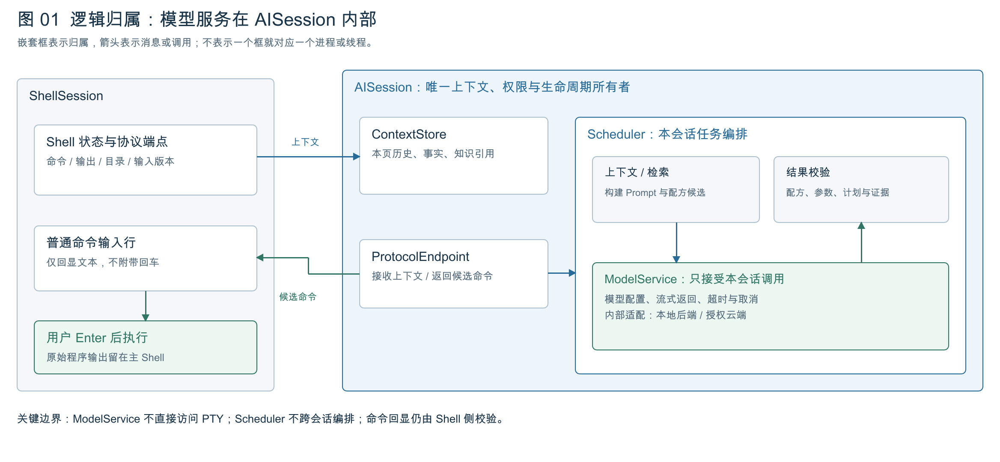
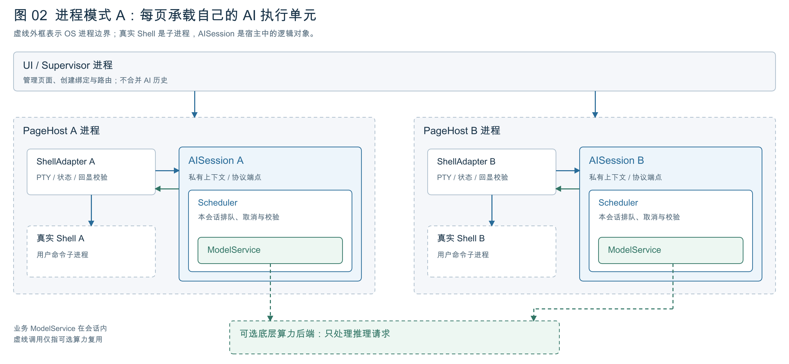
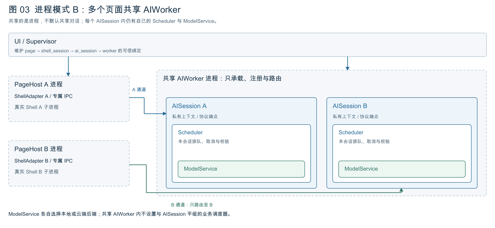
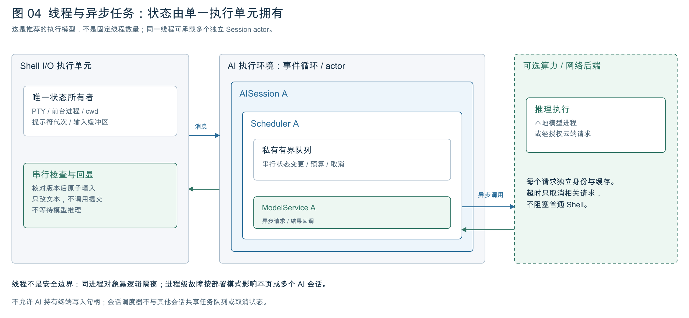
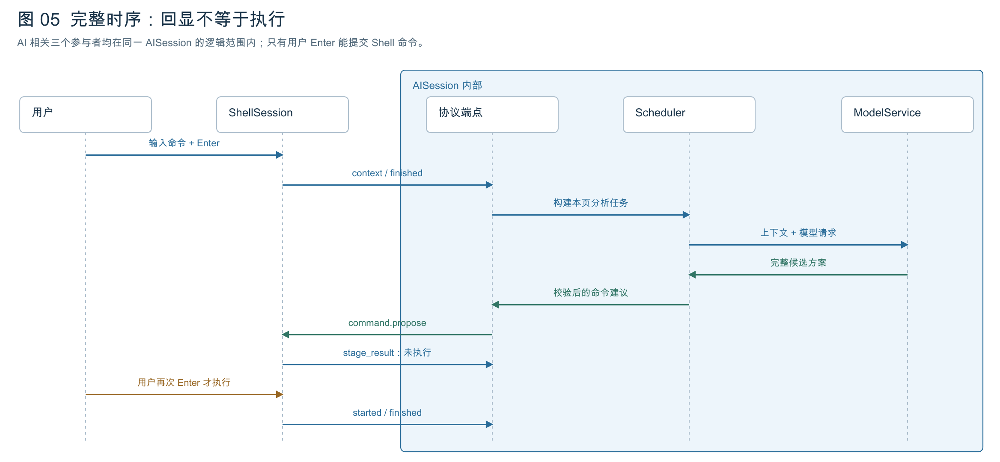
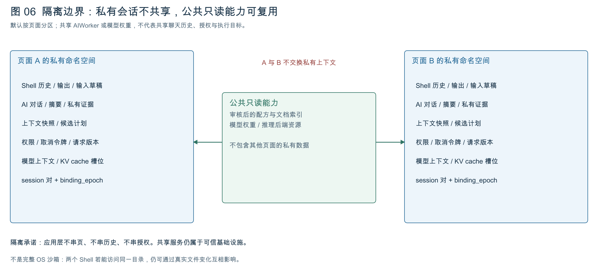
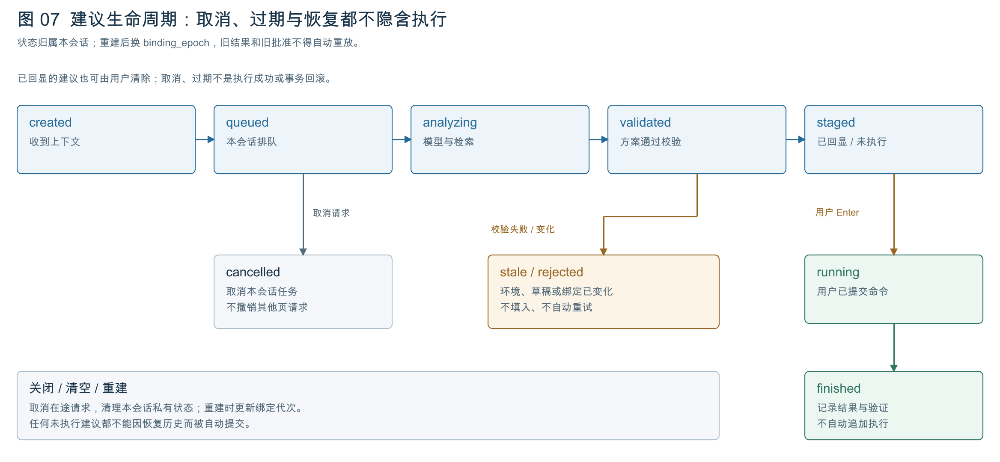

# Harmony 智能 Shell：Session 架构分析报告

> 日期：2026-09-27 · 版本：v1.0  
> 本文是 Session 架构 PDF 报告的 Markdown 版，便于持续讨论、检索与修订。  
> 依据：`SESSION_PROTOCOL.md` v0.3、`TECHNICAL_ARCHITECTURE.md` v0.4，以及 D-012 至 D-015 的讨论。  
> 状态：设计总结，不是已完成的运行时实现或 Harmony 平台适配认证。

## 1. 结论与产品边界

### 已确认的约束

1. 主窗口保持普通 Shell 界面，只呈现命令、提示符和程序真实输出；AI 解释、建议说明、风险及验证状态均在 AI 侧栏展示。
2. 默认每个页面绑定一个 ShellSession 和一个逻辑 AISession。不同页面不交换私有上下文。
3. 需要支持多个 Shell 页面共享一个 AI 宿主进程；共享进程不意味着合并逻辑会话或共享聊天历史。
4. Scheduler 与 ModelService 从属于 AISession，不作为与 AISession 平级的全局业务服务。
5. 通过校验的纯命令可以直接回显到空闲 Shell 的可编辑输入行，不额外要求“确认回显”；只有用户在 Shell 中按 Enter 才提交执行。
6. 产品聚焦命令与开发环境，不分析具体工程业务或源代码缺陷。用户也可在侧栏主动询问，侧栏中的 Enter 只提交问题。

### 实现建议与待验证事项

本文中的进程部署、actor、队列、IPC、路由字段与缓存隔离是当前技术建议。具体运行时、线程数、默认部署方式、模型后端、系统沙箱及目标设备适配仍待确认和验证。

核心区别：**Session 是逻辑状态边界，进程是部署与故障边界，线程是执行资源；三者不是一一对应。**

## 2. 对象职责与逻辑关系



| 对象 | 主要职责 | 明确不负责的内容 |
| --- | --- | --- |
| ShellSession | 终端状态、命令运行记录、输入缓冲区及最终回显检查 | 模型推理与 AI 对话历史 |
| ShellAdapter | 接入真实 Shell、采集状态、实现协议及行编辑集成 | 无条件向前台程序注入 PTY 字节 |
| AISession | 本页上下文、授权、协议端点与内部能力生命周期 | 其他页面的历史、权限与执行目标 |
| Scheduler | 编排本会话上下文构建、知识检索、模型调用、校验与取消 | 跨会话的全局业务调度 |
| ModelService | 本会话模型配置、请求、流式返回、超时及取消 | 直接写 Shell 或决定目标页面 |
| AIWorker | 承载、注册与路由一个或多个 AISession | 合并对话、构建跨页 Prompt 或代替会话编排 |
| UI / Supervisor | 页面管理、会话绑定、宿主生命周期和可信路由 | 自动扩大模型权限或跨页共享上下文 |
| 可选推理后端 | 提供实际模型推理与底层算力资源 | 成为会话外的全局业务 ModelService |

逻辑调用链：

```text
ShellSession
  → AISession 协议端点
    → 本会话 Scheduler
      → 上下文构建与知识检索
      → 本会话 ModelService
      ← 模型候选方案
      → 结果校验与命令生成
    ← 返回本会话候选命令
  ← 经协议回到原 ShellSession
  → Shell 侧原子检查后写入输入行
  → 等待用户 Enter
```

图中的嵌套描述逻辑归属及调用，不要求每个节点占有一个独立进程、线程或模型权重副本。对外通信端点始终是 AISession，内部服务不能绕过协议访问终端。

## 3. 进程部署模式 A：按页承载



### 建议结构

- UI / Supervisor 管理多个 PageHost。
- 每页 PageHost 内包含 ShellAdapter 和该页的 AISession。
- AISession 内部持有 Scheduler 与 ModelService。
- 真实 Shell 是 PageHost 的子进程，用户命令可继续创建子进程。
- ModelService 可调用独立的底层模型进程，或在独立授权后访问云端；具体后端未定。

### 故障边界

单次模型请求失败可局部处理，不应阻塞普通 Shell。但 PageHost 整体崩溃可能影响本页终端控制，不能将此模式描述为完整的 Shell / AI 进程隔离。

不同页面拥有不同宿主进程，有助于区分故障影响范围；是否需要更强的安全域或独立 AI 进程仍需验证。此方案保留，没有因引入共享 AIWorker 而被放弃。

## 4. 进程部署模式 B：共享 AIWorker



### 建议结构

```text
UI / Supervisor
  ├─ PageHost A → ShellAdapter A → 真实 Shell A
  ├─ PageHost B → ShellAdapter B → 真实 Shell B
  └─ AIWorker
       ├─ AISession A → Scheduler A → ModelService A
       └─ AISession B → Scheduler B → ModelService B
```

PageHost A 只连接 AISession A，PageHost B 只连接 AISession B。AIWorker 可以共用事件循环或执行资源，但不共用会话历史、授权与业务队列。

Supervisor 维护可信绑定：

```text
page_id + shell_session_id + ai_session_id + worker_id + binding_epoch
```

- `worker_id` 只是部署地址，不能作为历史、上下文或私有缓存的唯一索引。
- 路由校验绑定实际通信通道，不能只信任消息内自报的页面标识。
- 模型不能选择返回到哪个页面。
- AIWorker 崩溃会影响它承载的多个 AI 会话，但不应连带结束外部 PageHost 与真实 Shell。
- 重建绑定时更新 `binding_epoch`，拒绝旧请求的迟到结果。

**尚未采纳的扩展：** 多个 Shell 共用一个逻辑对话属于显式工作组模式，仍待讨论，不能随共享进程默认开启。

## 5. 线程、异步任务与非阻塞边界



### 推荐执行模型

| 执行单元 | 状态所有权 | 工作方式 |
| --- | --- | --- |
| Shell I/O 单元 | PTY、前台进程、cwd、提示符代次、输入版本 | 串行处理输入状态与回显检查，不等待模型推理 |
| AISession actor | 本会话历史、上下文、计划、授权、取消状态 | 有界消息队列与串行状态更新，耗时任务异步执行 |
| ModelService 请求任务 | 单次模型请求、流式片段、超时与响应关联 | 通过异步接口调用后端，返回所属会话 |
| 可选算力或网络后端 | 底层推理执行资源 | 与 Shell I/O 解耦，请求身份与私有缓存分开 |

两个逻辑执行单元不等于两个固定 OS 线程；一个事件循环可以承载多个独立 Session actor。具体线程数量和阻塞任务池由目标运行时与性能测试决定。

关键约束：

- 输入版本检查与命令写入必须在同一串行控制点完成，避免检查后用户输入变化导致覆盖。
- 阻塞模型推理、检索或网络请求不得占用 Shell I/O 执行路径。
- 每个会话调度器只管理自己的任务；宿主可以限制资源占用，但不接管会话工作流。
- 取消某个会话只影响它的请求与队列，不取消其他页面任务。
- 线程不是安全边界；共享进程内的会话隔离首先是应用层逻辑隔离。

## 6. 上下文与模型调用

ShellSession 向对应 AISession 提供本页的最小事实快照，例如命令、退出状态、限量输出、当前目录、环境摘要、提示符代次和输入版本。输出截断必须显式标记，不能把不完整输出当作完整事实。

AISession 保存快照，Scheduler 结合本页用户问题构建任务，再检索符合环境约束的知识与配方。文档证据与可执行配方分开处理，不将检索文本直接作为 Shell 命令执行。

ModelService 接收本会话上下文与模型配置，返回候选方案。模型输出经过程序校验与命令生成后，才允许形成协议中的命令建议。流式分析可以先显示在侧栏，但未完成的片段不能写入 Shell 输入行。

本地与云端只是 ModelService 的后端选择，不改变会话归属、路由或用户 Enter 执行规则。模型型号、端侧部署方式、缓存复用与上传授权细节不在本报告中定案。

## 7. 统一协议与端到端时序



### 消息与语义

| 消息 | 方向 | 语义 |
| --- | --- | --- |
| `shell.context.snapshot` | Shell → AI | 本页事实快照，包含上下文、提示符和输入版本 |
| `shell.context.changed` | Shell → AI | 目录、环境或目标变化，使相关旧建议失效 |
| `shell.command.finished` | Shell → AI | 命令结果、退出状态、限量输出及截断说明 |
| `ai.context.request` | AI → Shell | 请求补充只读信息，仍受本页授权和范围检查 |
| `ai.command.propose` | AI → Shell | 完整候选命令、配方版本、计划摘要及预期状态 |
| `shell.command.stage_result` | Shell → AI | 已回显或拒绝原因，不表示已经执行 |
| `shell.command.started` | Shell → AI | 用户提交后实际执行开始，不接受模型伪造 |
| `request.cancel` / `session.close` | 双向 / Supervisor | 取消请求或关闭绑定，阻止迟到消息继续生效 |

建议统一消息信封包含：

```text
protocol_version, message_id,
page_id, binding_epoch, shell_session_id, ai_session_id,
task_id, request_id, type, sequence, reply_to, payload
```

同进程可使用类型化队列，跨进程使用受保护 IPC；协议语义应保持一致。长度前缀 JSON 等编码只是候选实现，不是已验证的平台选型。

### 正常路径

1. 用户在 Shell 输入命令并按 Enter。
2. Shell 提供上下文和命令结果，AI 根据失败事件或本页询问创建任务。
3. Scheduler 构建上下文、检索知识并调用本会话 ModelService。
4. 完整候选方案返回，程序完成配方、参数与命令校验。
5. AISession 发送 `ai.command.propose` 给原 ShellSession。
6. Shell 原子检查当前状态，通过后填入纯命令文本，返回 `stage_result=staged`。
7. 用户可编辑、清除或在 Shell 中按 Enter；只有提交后才产生执行开始事件。
8. 执行输出留在主窗口，AI 解释与额外验证报告留在侧栏。

协议不提供模型可调用的 `shell.execute`。回显回执、执行开始和执行完成必须是不同事件。

## 8. 命令回显前的最终检查

依次校验以下条件，并在输入缓冲区所有者处完成最终原子检查与写入：

1. 页面、Session 对、绑定代次与真实通道一致。
2. 请求未取消，候选计划仍有效，重复建议不会被再次填入。
3. 上下文和目录未过期，提示符代次及输入版本匹配。
4. 前台处于空闲 Shell 提示符，而非编辑器、REPL、续行输入或其他交互程序。
5. 用户草稿为空，或仅存在可安全替换且未被用户编辑的旧 AI 草稿；不得覆盖用户输入。
6. 命令完整、按目标 Shell 进行安全转义，不包含隐藏换行或控制字符。
7. 写入动作仅更新可编辑文本，不附带 Enter，也不调用提交接口。

拒绝原因可包括 `INPUT_CHANGED`、`SHELL_BUSY`、`STALE_CONTEXT`、`BINDING_MISMATCH`、`INVALID_PROPOSAL`。拒绝说明只进入侧栏，主 Shell 保持原样。

用户编辑命令后，旧计划的验证结果不能继续被视为对修改后命令的保证。回执丢失或重试也不能导致重复回显。

## 9. 数据隔离与共享资源



| 必须按页面 / 会话隔离 | 可作为公共能力复用 |
| --- | --- |
| Shell 历史、输出与输入草稿 | 审核后的只读文档索引 |
| AI 对话、摘要与私有证据 | 公共可执行配方定义 |
| 上下文快照、候选计划及执行关联 | 模型权重 |
| 授权、取消令牌与请求版本 | 底层推理执行资源 |
| 模型上下文及私有 KV cache 槽位 | 不包含其他页面私有状态的公共资源 |

共享权重或算力不意味着可以混合会话 Prompt、缓存、云端对话或权限。返回结果必须关联原始会话与请求。

这里承诺的是应用层不串页、不串历史、不串授权，不是完整 OS 沙箱。相同用户下的两个 Shell 若访问同一目录，仍可通过真实文件变化互相影响；如需文件层面隔离，必须另行设计系统沙箱与独立工作区。

## 10. 生命周期、取消与故障恢复



正常状态路径：

```text
created → queued → analyzing → validated → staged
                                              ↓ 用户 Enter
                                           running → finished
```

异常路径包括 `cancelled`、`stale` 与 `rejected`。图中为主要路径示意，不是所有状态转移的最终形式化定义。

- 创建 AISession 时初始化本会话 Scheduler、ModelService 配置、上下文与协议绑定。
- 取消作用于本会话的在途请求、排队任务及未执行建议，不等同于撤销已运行命令产生的副作用。
- 用户可以清除已回显建议；上下文、输入或绑定变化可使建议过期。
- 关闭会话时清理私有状态与请求；共享后端仍被其他会话使用时不能一并终止。
- PageHost 或 AIWorker 重建后更新绑定代次，拒绝旧结果，不重放用户 Enter。
- 恢复历史不恢复隐含执行权限，不能自动填入并执行上一次未完成的建议。
- 切换模型只修改本会话配置；在途结果必须取消或保留原模型版本关联，不能混接。

## 11. 第一版验收清单

- [ ] A/B 页请求并发、响应乱序时不串页、不改绑。
- [ ] 用户编辑或开始下一条命令后，旧建议不能覆盖输入。
- [ ] 编辑器、REPL、续行与输入法提交期间不误注入命令。
- [ ] 回显不执行；AI 侧栏 Enter 只提交问题。
- [ ] 重复 proposal 和回执丢失不产生重复回显。
- [ ] 取消或关闭 A 不影响 B 的历史、队列、授权与输入。
- [ ] 共享 AIWorker 故障不结束外部普通 Shell。
- [ ] 重绑后拒绝旧消息，不重放批准或 Enter。
- [ ] 私有模型缓存与云端对话不泄漏其他页面上下文。
- [ ] AI 说明与验证状态不污染主窗口的原始程序输出。

以上是待实现原型的验收要求，尚未作为运行时测试通过。

## 12. 待决定事项

| 议题 | 当前状态 |
| --- | --- |
| 默认进程模式 | 按页承载与共享 AIWorker 均保留，待比较后决定 |
| 线程与 IPC | 运行时、线程数、队列预算、背压及连接实现待验证 |
| 模型后端 | 本地或云端、具体模型、权重复用及缓存策略待选型 |
| 云端上传 | 需要明确授权、数据范围与取消语义 |
| 平台适配 | 设备、系统版本、Shell、PTY、行编辑集成与权限待实测 |
| 工作组模式 | 多 Shell 共用一个逻辑对话仍属备选，默认不开启 |

## 13. 设计演进与历史保留

- **D-012：** 确认一页一对 Session、页面隔离和统一协议，提出按页 PageHost 部署建议。
- **D-013：** 增加多个页面共享 AI 进程的场景；保留独立逻辑 AISession，不默认共享对话。
- **D-014：** 确认 Scheduler 与 ModelService 下沉到 AISession 内部。
- ~~在 AIWorker 下设置与 AISession 平级的全局业务调度器和模型网关。~~ **已替代，2026-09-27，关联 D-014 / DEC-012：** 改为各 AISession 的内部能力；共享推理后端仅作为可选底层资源。
- **D-015：** 汇总为 PDF 与七张独立图解，不新增架构决策。
- **D-016：** 补充本 Markdown 分析报告，与 PDF 保持相同设计结论，不覆盖历史记录。

## 14. 配套文件

- PDF：`output/pdf/harmony-shell-session-architecture.pdf`
- 独立图目录：`output/diagrams/session-architecture/`，每张图提供 PNG 与 SVG。
- 图解打包：`output/session-architecture-diagrams.zip`
- PDF 与图解生成脚本：`design/build_session_report.py`
- 协议详细设计：`SESSION_PROTOCOL.md`
- 整体技术框架：`TECHNICAL_ARCHITECTURE.md`
- 持续讨论与决策：`PROJECT_DISCUSSIONS.md`

本文和 PDF 当前为同一版设计结论的两种呈现，尚未建立 Markdown 自动生成 PDF 的流水线。后续变更应同步修订相关文档并在讨论记录中追加说明。
